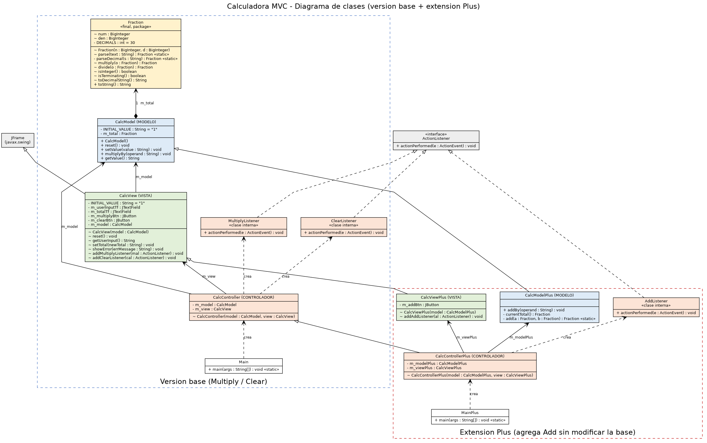
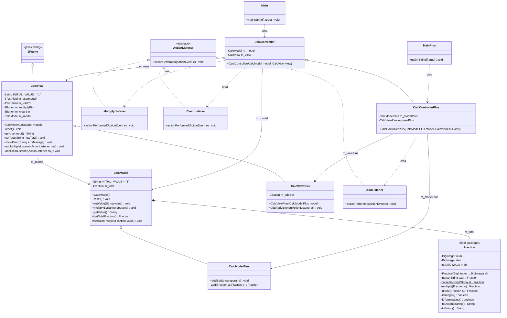

# 2. Diagrama de clases

## 2.1 Imagen

También disponible en vectorial: [`img/diagrama-clases.svg`](img/diagrama-clases.svg) (código fuente Graphviz: [`img/diagrama-clases.dot`](img/diagrama-clases.dot)).

## 2.2 Versión Mermaid (GitHub la dibuja automáticamente)

## 2.3 Leyenda de relaciones

| Símbolo | Significado | Ejemplo |
|---------|-------------|---------|
| Flecha con triángulo vacío (línea continua) | **Herencia** (`extends`) | `CalcModelPlus` → `CalcModel` |
| Flecha con triángulo vacío (línea punteada) | **Implementación** de interfaz (`implements`) | `MultiplyListener` → `ActionListener` |
| Rombo negro | **Composición**: el modelo posee y controla a su `Fraction` | `CalcModel` ◆→ `Fraction` |
| Flecha simple | **Asociación**: la clase guarda una referencia a la otra | `CalcController` → `CalcView` |
| Flecha punteada | **Dependencia**: una clase crea o usa a otra | `Main` ⇢ `CalcController` |

Visibilidad: `+` público, `-` privado, `~` paquete (sin modificador).

## 2.4 Responsabilidad de cada clase

| Clase | Capa | Responsabilidad |
|-------|------|-----------------|
| `Fraction` | Modelo (apoyo) | Representa un número como fracción exacta (`BigInteger`), lo interpreta desde texto y lo multiplica. |
| `CalcModel` | Modelo | Guarda el total y multiplica. No conoce la ventana. |
| `CalcView` | Vista | Dibuja la ventana y entrega/recibe texto. No hace cálculos. |
| `CalcController` | Controlador | Conecta botones con el modelo y avisa a la vista. |
| `MultiplyListener` / `ClearListener` | Controlador | Acciones de los botones Multiply y Clear (clases internas). |
| `Main` | Arranque | Crea modelo, vista y controlador (versión base). |
| `CalcModelPlus` | Modelo (extensión) | Hereda de `CalcModel` y agrega la **suma**. |
| `CalcViewPlus` | Vista (extensión) | Hereda de `CalcView` y agrega el botón **Add**. |
| `CalcControllerPlus` / `AddListener` | Controlador (extensión) | Hereda de `CalcController` y agrega la acción de Add. |
| `MainPlus` | Arranque | Crea las clases Plus (versión con suma). |
